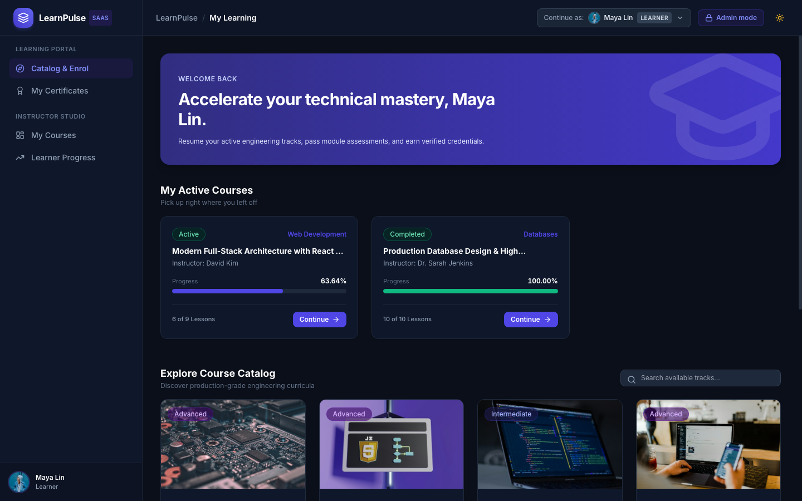
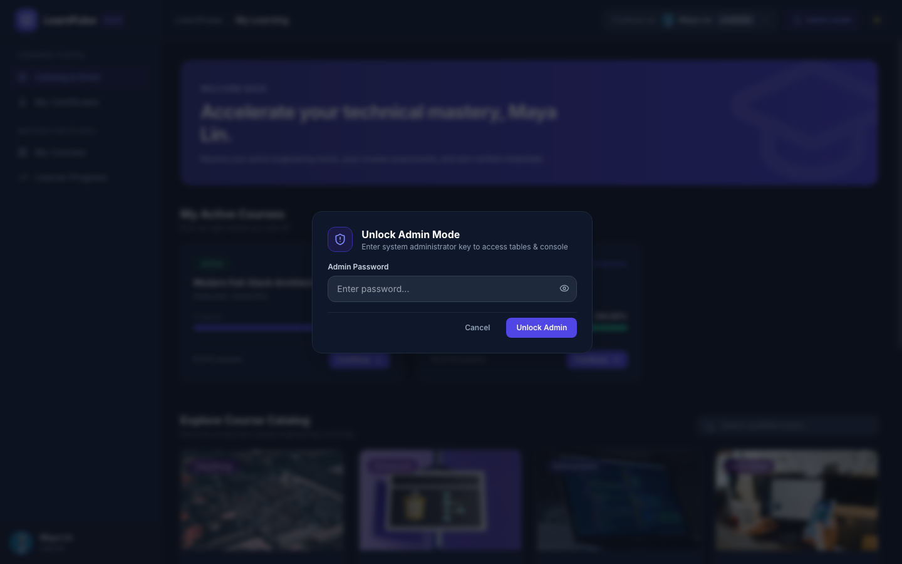
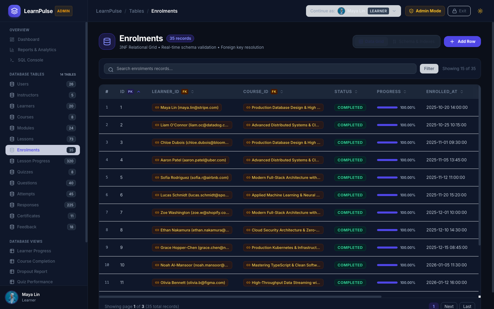
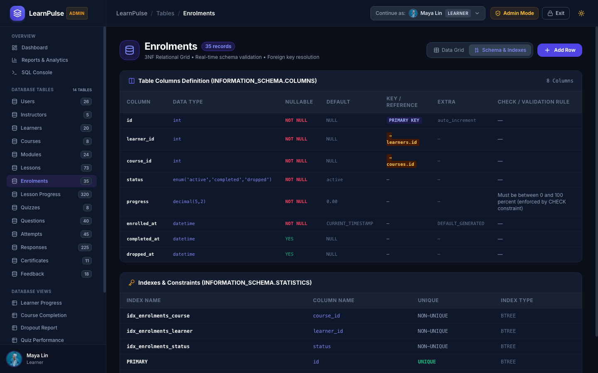
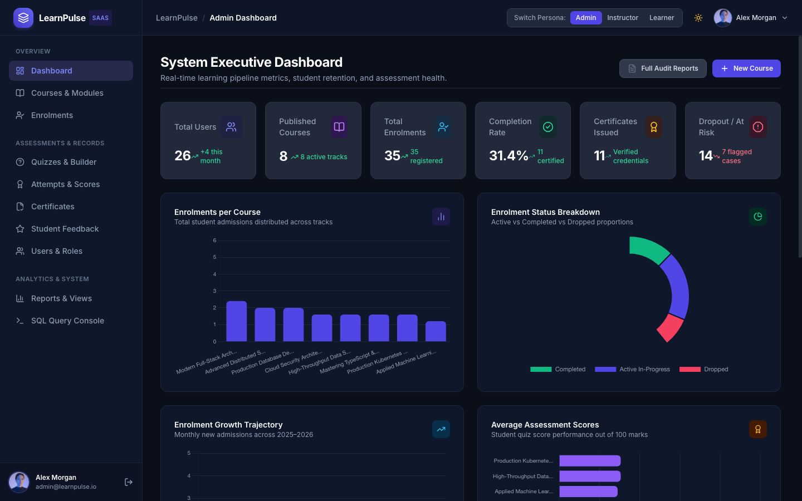
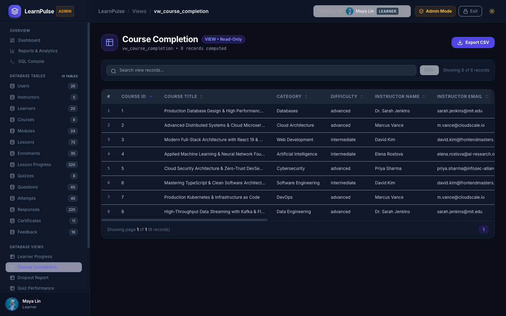
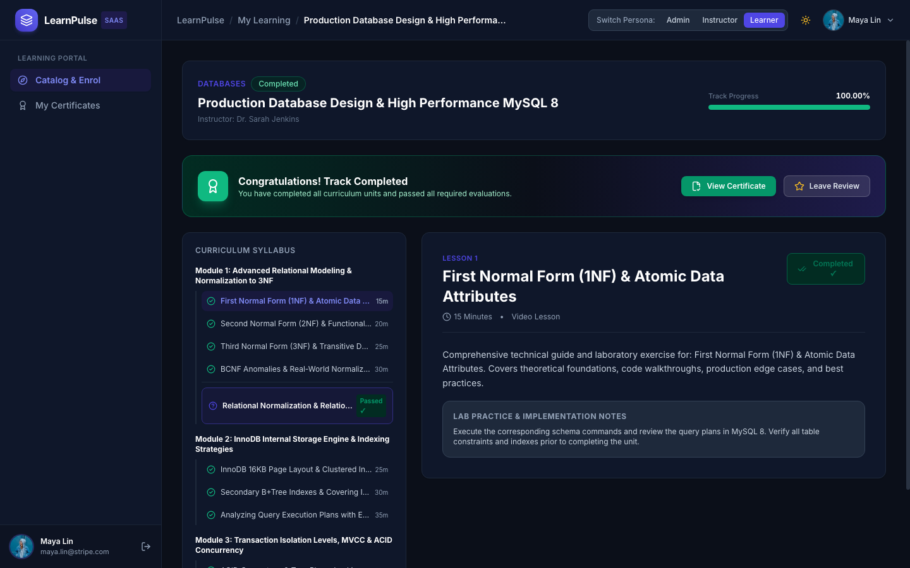
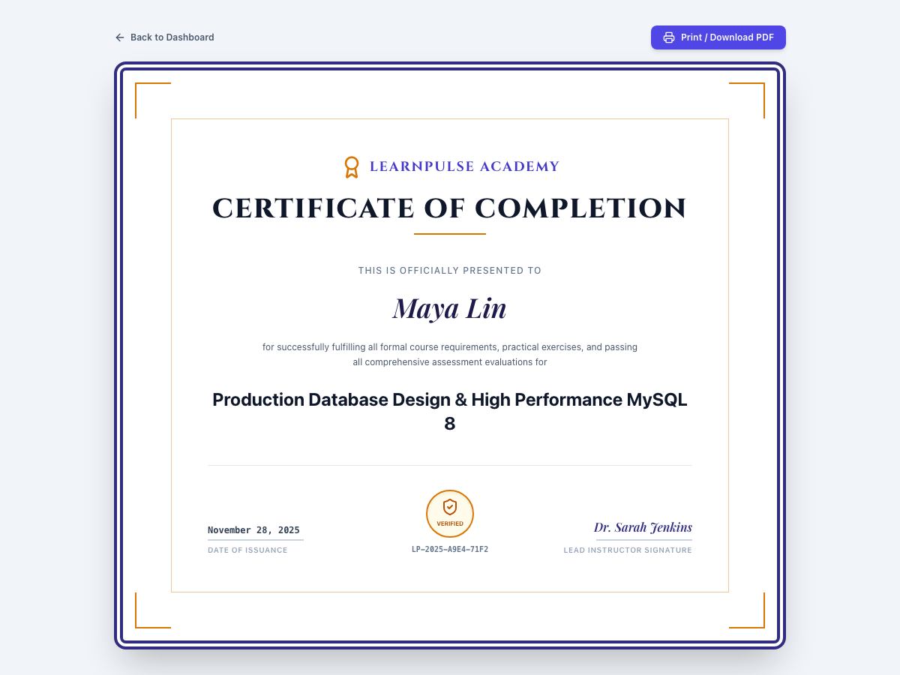

# LearnPulse SaaS — Online Course Learning Progress Management System
**Project 34 (MySQL 8 + Python Flask Enterprise Edition — Phase 1, 2 & 3)**

[](https://www.python.org/)
[](https://www.mysql.com/)
[](https://tailwindcss.com/)
[](https://alpinejs.dev/)
[](https://www.chartjs.org/)

An enterprise-grade, high-polish learning management platform engineered to the standards of modern SaaS products (Linear, Stripe Dashboard). LearnPulse delivers strict 3NF relational data integrity, ACID-compliant stored procedures, automated quiz scoring via MySQL `JSON_TABLE`, real-time course progress computation, and verifiable digital certificates.

---

## 📸 Visual Highlights (Phase 3 Enterprise Edition)

| Normal Mode (Direct Open, No Login) | Admin Password Unlock Modal |
| :---: | :---: |
|  |  |

| Table Browser (All 14 Tables + Live Row Badges) | Schema & Indexes Introspection Tab |
| :---: | :---: |
|  |  |

| Executive Dashboard | Database Views Browser (Read-Only) |
| :---: | :---: |
|  |  |

| Student Course Player & Syllabus | Verifiable Digital Certificate |
| :---: | :---: |
|  |  |

---

## ⚡ Phase 3: Access Model & Architecture

### 1. Seamless Access Model (No Login Page)
- **Direct Entry**: The application opens directly into **Normal mode** with zero login walls or password prompts. Anyone can explore the full course catalog, enroll, complete lessons, attempt quizzes, view certificates, and review feedback.
- **Top Bar "Continue as" Dropdown**: A top-bar dropdown lets users switch between 20 learners and 5 instructors without entering passwords.

### 2. Admin Mode Toggle & Security
- **Admin Lock Button**: In Normal mode, clicking the top bar's **Admin mode** button opens a centered modal asking for the system admin key.
- **Server-Side HMAC Verification**: The password (`admin16`) is verified strictly on the server using `hmac.compare_digest`. The password is never present in HTML or JavaScript.
- **Error Shake & 5-Attempt Rate Limiting**: Incorrect passwords display inline error text and trigger a CSS shake animation. After 5 incorrect attempts, the form is locked for 30 seconds with a visible countdown timer.
- **30-Minute Inactivity Timeout**: Admin mode automatically expires after 30 minutes of inactivity, clearing session flags and returning to Normal mode.
- **Route Protection**: Every `/admin` endpoint and table operation is guarded by an `@admin_required` decorator that redirects unauthorized requests to Normal mode.
- **Top Bar Indicator**: While in Admin mode, the top bar displays an amber `Admin Mode` shield badge and an **Exit Admin Mode** button.

### 3. Universal Table Browser (`/admin/tables/<table_name>`)
A reusable data grid supporting all 14 database tables:
- **Live Row-Count Badges**: The Admin sidebar displays real-time row counts for every table:
  `users` (26), `instructors` (5), `learners` (20), `courses` (8), `modules` (24), `lessons` (73), `enrolments` (35), `lesson_progress` (320), `quizzes` (8), `questions` (40), `attempts` (45), `responses` (225), `certificates` (11), `feedback` (18).
- **Foreign Key Resolution**: Foreign key columns display human-readable names (e.g. `Maya Lin (maya.lin@stripe.com)` instead of raw `learner_id: 1`) with links to referenced records.
- **Dynamic Slide-Over Forms**: Add and Edit forms are dynamically generated from `INFORMATION_SCHEMA`:
  - `ENUM` columns render as styled dropdowns.
  - Foreign key columns render as searchable select menus with resolved entity names.
  - Required fields are marked with red asterisks.
  - `CHECK` constraint boundaries (progress 0–100, ratings 1–5, price >= 0) are rendered as inline helper text.
- **Schema & Indexes Tab**: Dedicated introspection tab displaying column types, nullability, defaults, primary/foreign keys, and `INFORMATION_SCHEMA.STATISTICS` index metadata.
- **Friendly Error Translation**: Raw SQL exceptions are translated into clear, helpful toast notifications (e.g. duplicate enrollment, attempt limits exceeded, progress outside 0–100).
- **Confirmation Modals**: Delete actions require explicit confirmation through a styled modal naming the record.

### 4. Database Views Browser (`/admin/views/<view_name>`)
Read-only data grids for all 6 analytical views with server-side sorting, text search, pagination, and one-click **Export CSV** download:
- `vw_learner_progress`
- `vw_course_completion`
- `vw_dropout_report`
- `vw_quiz_performance`
- `vw_certificate_eligibility`
- `vw_instructor_summary`

---

## 🛠️ Tech Stack

- **Backend**: Python 3.10+, Flask, `mysql-connector-python` (strictly raw parameterized SQL; zero ORM abstractions).
- **Database**: MySQL 8.0 with InnoDB, ACID transactions, check constraints, stored procedures, triggers, and views.
- **Frontend**: Jinja2 templates, Tailwind CSS (CDN), Alpine.js 3, Chart.js 4, Lucide Icons, Google Inter font.

---

## 🚀 Quickstart & Setup Guide

### 1. Prerequisites
- Python 3.10 or higher
- MySQL 8.0 running locally on port `3306`

### 2. Configure Environment (`.env`)
Create or edit `.env` in the project root:
```env
DB_HOST=127.0.0.1
DB_PORT=3306
DB_USER=root
DB_PASSWORD=root
DB_NAME=course_progress_db
PORT=5001
SECRET_KEY=super-secret-key-change-in-production-linear-saas-2026
ADMIN_PASSWORD=admin16
```

### 3. Install Python Dependencies
```bash
# Create and activate virtual environment
python3 -m venv venv
source venv/bin/activate  # On Windows: venv\Scripts\activate

# Install required packages
pip install flask mysql-connector-python python-dotenv
```

### 4. Initialize Database & Seed Data
Execute the setup script to drop existing tables, create the 3NF schema, install stored procedures, create views, and populate realistic seed data:
```bash
python setup_db.py
```

### 5. Run Automated Test Audits
Validate database constraints and business rules (Phase 1):
```bash
python verify_phase1.py
```

Validate web application endpoints and security guards (Phase 2):
```bash
python test_web_routes.py
```

Validate Phase 3 access model, HMAC unlock, table browser, and views:
```bash
python test_phase3.py
```

### 6. Launch Web Server
```bash
python app.py
```
Open your browser and navigate to:
```
http://127.0.0.1:5001
```

---

## 🔑 Access Credentials & Personas

- **Normal Mode (Default)**: Opens immediately without passwords. Use the **Continue as** dropdown in the top bar to switch between personas:
  - Learner: **Maya Lin** (`maya.lin@stripe.com`)
  - Instructor: **Dr. Sarah Jenkins** (`sarah.jenkins@mit.edu`)
- **Admin Mode Unlock**:
  - Click **Admin mode** in the top bar.
  - Password: `admin16`
